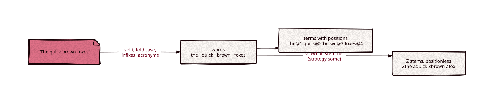

# analysis

Part of [Kronuz C++ Libraries](https://github.com/Kronuz/cpp-libraries), a collection of small, reusable C++ libraries.

[](https://github.com/Kronuz/analysis/actions/workflows/ci.yml)

[](LICENSE)


Turn text into index terms in C++20, exactly as Xapian's `TermGenerator` does, at
1.8x its speed. Words, case folding, `Z`-prefixed stems, stop words, CJK n-grams,
wdf, and positions all match, and 966 recorded vectors prove it.



## ✨ Highlights

- 🎯 **Xapian-exact**: the same terms, wdf, and positions as Xapian 2.1.0, checked
  against 966 oracle vectors and sweeps over all 1,114,112 code points.
- ⚡ **1.8x faster** than Xapian's `TermGenerator` on English Wikipedia, with and
  without stemming.
- 🌏 **Unicode-aware**: UTF-8 with ISO-8859-1 fallback, infixes like `3.14` and
  `o'clock`, suffixes like `c++`, acronyms like `U.S.A.`, and CJK n-grams.
- 🌱 **Stemming and stopping** strategies (`none`, `some`, `all`, `all_z`) with any
  [snowball](https://github.com/Kronuz/snowball) stemmer.
- 🧪 **Fuzzed**: a libFuzzer target ran 6 million inputs clean; ASan and UBSan in CI.

## 📦 Installation

Requires a C++20 compiler; CMake 3.14 or newer for the CMake route. It brings
[unicode](https://github.com/Kronuz/unicode) and [snowball](https://github.com/Kronuz/snowball).
CI builds it on Linux (x86_64, arm64), macOS (arm64, x86_64), and FreeBSD, plus ASan,
UBSan, and TSan builds.

```cmake
include(FetchContent)
FetchContent_Declare(analysis
  GIT_REPOSITORY https://github.com/Kronuz/analysis.git
  GIT_TAG        main)
FetchContent_MakeAvailable(analysis)

target_link_libraries(my_app PRIVATE analysis::analysis)
```

## 🚀 Quick start

```cpp
#include "analysis.hh"

snowball::stemmer english("english");
analysis::term_generator g;
g.stemmer = &english;                       // stem_strategy::some by default
g.index_text("The quick brown foxes", [](std::string_view term, std::uint32_t wdf, std::uint32_t pos) {
	// the@1, quick@2, brown@3, foxes@4, and positionless Zthe, Zquick, Zbrown, Zfox
}, {.wdf_inc = 1, .prefix = "", .positions = true});
```

`term_generator` holds the strategies (`stem`, `stop`, `cjk_ngram`, `max_word_length`),
a non-owning `stemmer` and `stop_words`, and the running position (`termpos`,
`set_termpos`, `increase_termpos`). The sink receives each term occurrence with its wdf
increment and position (0 for none); the view is valid during the call.

## ⚡ Performance

Indexing 10,000 English Wikipedia articles (9.6 MB) into per-document maps of terms to
wdf and positions, best of three, on an Intel i9-9980HK, Apple clang `-O3`
(`bench/bench.cc`), against Xapian 2.1.0's `TermGenerator` into `Xapian::Document`
on the same text:

| Strategy | analysis | Xapian | Ratio |
|---|---:|---:|---:|
| `none` | 29.4 MB/s | 16.1 MB/s | 1.8x |
| `some`, English stemmer | 12.0 MB/s | 6.7 MB/s | 1.8x |

## 🎯 When to use it

- ✅ Indexing text so its terms match a Xapian index, or a fast Xapian-style analyzer.
- ❌ Other analyzers' rules (Lucene's StandardTokenizer, ICU word breaks): this
  reproduces Xapian's, quirks included.

## 📚 Documentation

- [docs/RULES.md](docs/RULES.md): every tokenization rule and how it is verified.
- [AGENTS.md](AGENTS.md): repository map and invariants.

## 🛠️ Building and testing

```sh
cmake -S . -B build && cmake --build build && ctest --test-dir build
build/analysis_bench CORPUS_JSONL N
```

## 🤝 Contributing

Issues and pull requests are welcome. Read [AGENTS.md](AGENTS.md) first. CI must
pass on every platform.

## 📄 License

MIT, Copyright (c) 2026 Germán Méndez Bravo. See [LICENSE](LICENSE).
